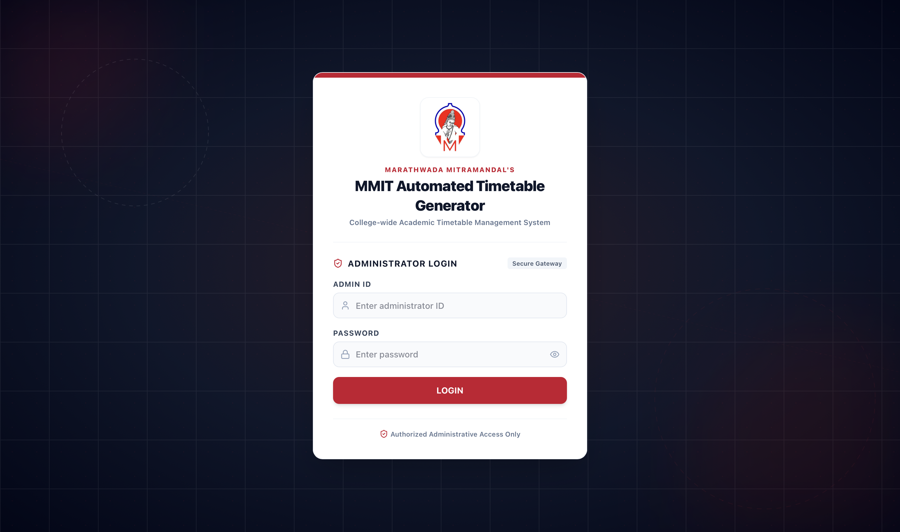
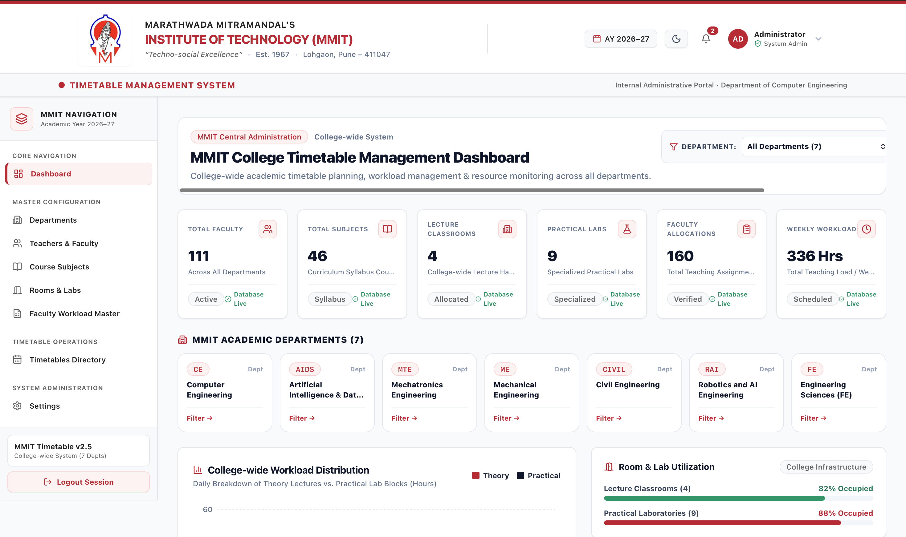
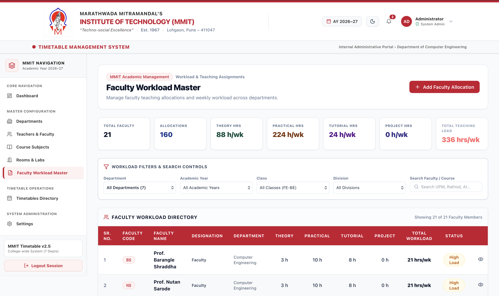
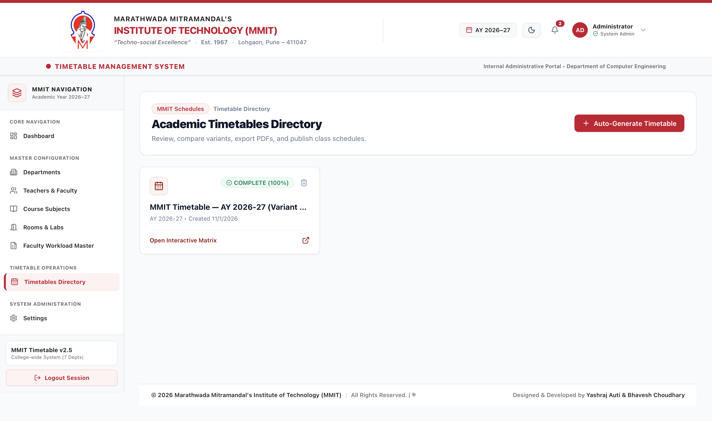
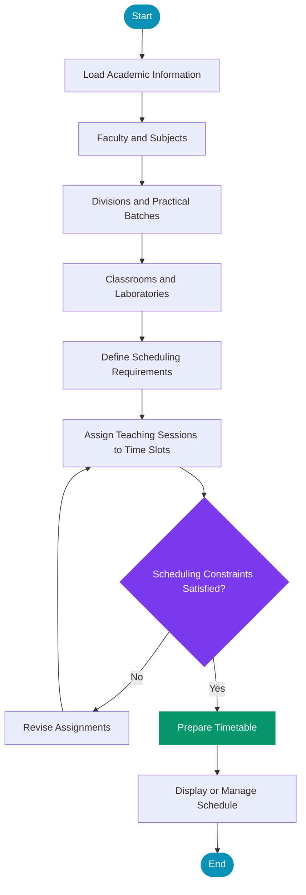

<div align="center">


<h3>🎓 College Timetable Management System</h3>

<p>
  A web-based solution for simplifying academic scheduling,
  managing faculty workloads, and organizing college timetables.
</p>

<br/>

<a href="https://mmit-timetable.vercel.app/login">
  
</a>
<a href="https://github.com/YashrajAuti/college-timetable-system">
  
</a>
<a href="https://github.com/YashrajAuti">
  
</a>

<br/><br/>


</div>

---

## 📌 About the Project

The **College Timetable Management System** is a web application designed to simplify timetable preparation and academic scheduling for engineering colleges.

Creating college timetables involves coordinating faculty members, subjects, divisions, practical batches, classrooms, laboratories, and weekly teaching loads. Managing these constraints manually can be time-consuming and may lead to scheduling conflicts.

This project aims to centralize academic scheduling and streamline timetable management through a web-based platform.

### 🎯 Project Objectives

- Simplify academic timetable preparation.
- Organize faculty, subjects, classrooms, and practical batches.
- Manage weekly faculty teaching loads.
- Reduce timetable clashes and scheduling conflicts.
- Support structured academic scheduling across divisions.
- Provide a foundation for department-wide timetable management.

---

## 🖥️ Application Screenshots

<div align="center">

### 🔐 Login Page



*Application login interface.*

### 📊 Dashboard



*Centralized academic management dashboard.*

### 👨‍🏫 Faculty Management



*Faculty information and teaching assignment management.*

### 📅 Timetable Generation



*Academic timetable and scheduling interface.*

</div>

> **Screenshot setup:** Create a `screenshots` folder in your repository and add your actual screenshots using the filenames shown above. Until those files exist, the images will not display. Replace the filenames if your screenshots use different names.

---

## ✨ Key Features

<table>
<tr>
<td width="50%">

### 📅 Timetable Management
Organize academic schedules for classes and divisions.

</td>
<td width="50%">

### 👨‍🏫 Faculty Management
Maintain faculty information and teaching assignments.

</td>
</tr>
<tr>
<td width="50%">

### 📚 Subject Management
Manage subjects and their associated academic requirements.

</td>
<td width="50%">

### 🏫 Classroom & Laboratory Management
Organize teaching spaces and practical-session resources.

</td>
</tr>
<tr>
<td width="50%">

### 👥 Division & Batch Management
Structure academic divisions and practical batches.

</td>
<td width="50%">

### ⚖️ Faculty Workload Management
Track and organize weekly teaching-load requirements.

</td>
</tr>
<tr>
<td width="50%">

### 🤖 Timetable Scheduling
Generate schedules according to the constraints supported by the application.

</td>
<td width="50%">

### 🌐 Web-Based Access
Access the application through a browser.

</td>
</tr>
</table>

---

## 🛠️ Technology Stack

<div align="center">


</div>

The project uses a modern web-development stack. Verify the repository's dependencies before treating every icon above as a confirmed project dependency.

| Technology | Purpose |
|---|---|
| Next.js | Web application framework |
| React | Component-based user interface |
| TypeScript / JavaScript | Application logic |
| Node.js | JavaScript runtime for supported server-side components |
| Backend API | Communication between application components |
| Vercel | Frontend deployment |

---

## 🧠 How the Scheduling System Works

The timetable-generation process involves collecting academic requirements, assigning teaching sessions to suitable time slots, and organizing the resulting schedule.



### Scheduling Considerations

A timetable-generation system may need to account for:

- Faculty availability and overlapping assignments.
- Classroom and laboratory availability.
- Division and practical-batch requirements.
- Subject-wise weekly teaching loads.
- Lecture and practical-session durations.
- Valid day and time-slot assignments.

The actual scheduling algorithm and constraint-handling behavior should be documented according to the repository's implementation.

---

## 🚀 Live Application

<div align="center">

<a href="https://mmit-timetable.vercel.app/login">
  
</a>

<p>Explore the deployed College Timetable Management System.</p>

</div>

**Live Website:** https://mmit-timetable.vercel.app/login

**Source Code:** https://github.com/YashrajAuti/college-timetable-system

*Access to certain pages or functions may require authorized login credentials.*

---

## 💻 Run Locally

### Prerequisites

- Node.js
- npm
- Git

### 1. Clone the Repository

```bash
git clone https://github.com/YashrajAuti/college-timetable-system.git
```

### 2. Open the Project Directory

```bash
cd college-timetable-system
```

### 3. Install Dependencies

```bash
npm install
```

### 4. Configure Environment Variables

Review the project's environment configuration and set the required API URLs and other environment variables.

Never commit credentials, API keys, or production secrets.

### 5. Start the Development Server

For a standard Next.js application:

```bash
npm run dev
```

Open the local URL displayed in your terminal. It is commonly:

```text
http://localhost:3000
```

> **Note:** These commands assume the root directory contains the Next.js application. If the frontend and backend have separate package files, follow the setup instructions for each component.

---

## 📂 Project Structure

A typical Next.js application may contain the following directories. Adjust this section to match your actual repository.

```text
college-timetable-system/
│
├── app/                 # Application routes
├── components/          # Reusable UI components
├── public/              # Static assets
├── lib/                 # Shared utilities
├── package.json         # Dependencies and scripts
├── .gitignore           # Git exclusions
├── screenshots/         # README screenshots
└── README.md            # Project documentation
```

---

## 📈 GitHub Statistics

<div align="center">

<a href="https://github.com/YashrajAuti">
  
</a>

<a href="https://github.com/YashrajAuti">
  
</a>

<br/>


</div>

---

## 🔮 Future Enhancements

Potential improvements for future versions include:

- 📄 Export timetables to PDF and Excel.
- 📊 Faculty workload analytics.
- 🔄 Timetable adjustments when faculty or rooms become unavailable.
- 🔔 Notifications for timetable changes.
- 🏢 Scheduling support for multiple departments.
- 📱 Further improvements to mobile usability.
- 📈 Classroom utilization and scheduling reports.

---

## 👨‍💻 Developer

<div align="center">


### Yashraj Auti

**Computer Engineering Student | Web Developer**

<a href="https://github.com/YashrajAuti">
  
</a>

*Building practical software solutions for real-world problems.*

</div>

---

## 🤝 Contributions

Suggestions, bug reports, and improvements are welcome.

1. Fork the repository.
2. Create a feature branch.
3. Make your changes.
4. Test the changes.
5. Submit a pull request describing your improvements.

---

## 📄 License

Refer to the license included in the repository, if any, for the terms governing use and distribution.

---

<div align="center">

### ⭐ Thanks for visiting!

If you find this project useful, consider visiting the live application and exploring the source code.

**College Timetable Management System**

<sub>Developed by Yashraj Auti</sub>

</div>
